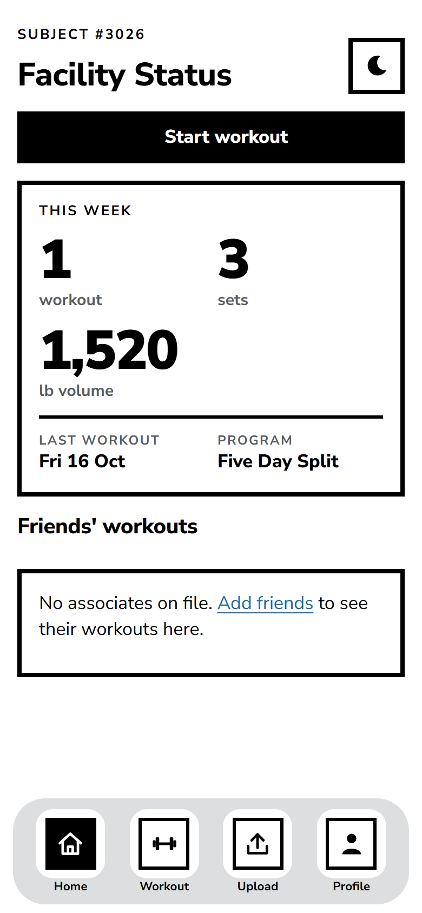
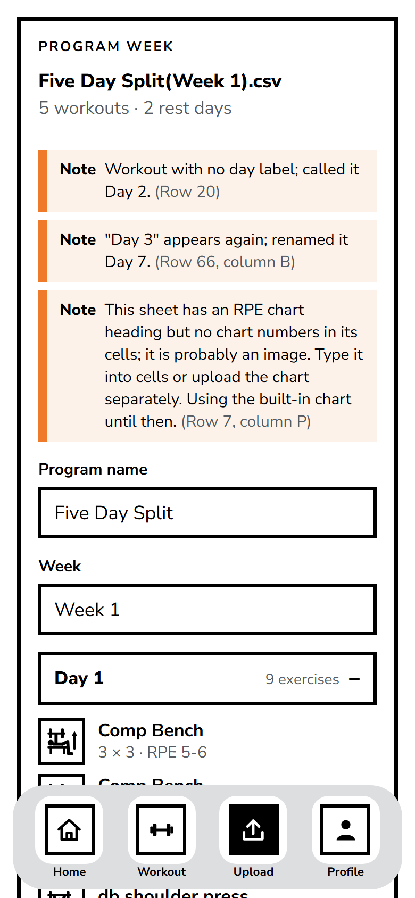
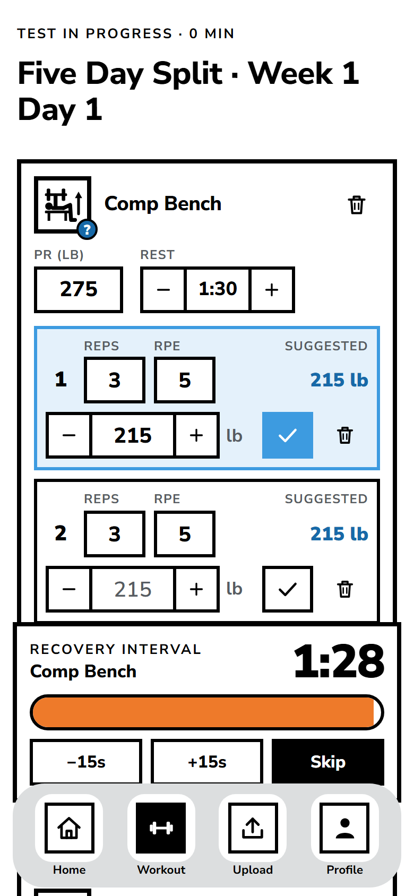
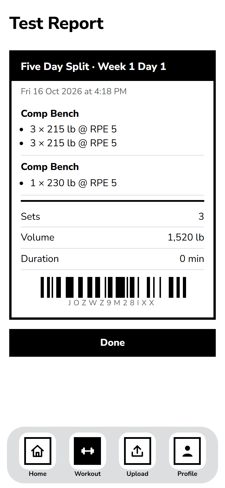
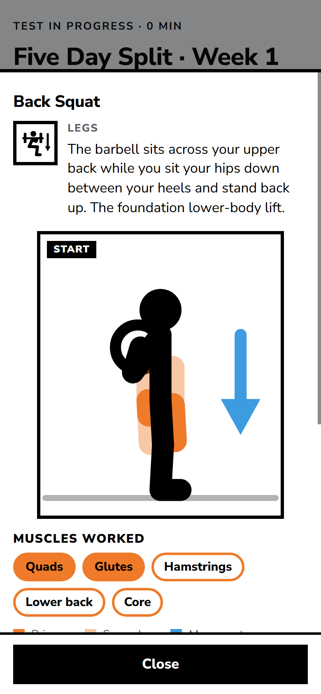

# Mussel

> A mobile-only workout tracker built around **your own training program and RPE chart**, from the
> testing wing of the fictional **Remixd Kinetics Laboratory**.
> _Results may vary. Gains may not._

**Live:** [mussel-a2067.web.app](https://mussel-a2067.web.app) (open it on a phone, then "Add to Home Screen")

Upload the spreadsheet your coach gave you (exported as CSV) and Mussel turns it into ready-to-log
workouts. For every set it suggests a weight from your max and an RPE-to-%1RM chart (yours, or a
built-in one), then updates your estimated max from what you actually lifted. It's an installable
PWA for iOS and Android, portrait only, and works offline in a gym with no signal.

<p>
  
  
  
  
</p>

## What it does

- **Program import.** A hand-written CSV parser reads a real coaching sheet: day blocks, sets,
  reps (`6-8`, `AMRAP`), prescriptions (`RPE 8`, `5-6`, `-15%` back-off, `100kg`) and coach notes.
  It repairs messy day numbering and reports every problem with its row and column.
- **Effort charts.** Upload an RPE or RIR chart in any orientation, with comma, semicolon or tab
  delimiters, and percentages written as `87`, `87%` or `0.87`. Lookups interpolate between cells.
- **Workout logging.** Each exercise has a PR field, a suggested weight per set (PR × chart %,
  rounded to the plate), adjustable weight, RPE or RIR entry, and its own rest timer.
- **Exercise guides.** Every built-in exercise has a two-frame animation of the lab's stick figure
  with the target muscles highlighted, plus steps and tips.
- **Friends.** Add friends by username and see each other's finished workouts, and nothing else.
- **Polish.** Dark mode, optional beeps and vibration, an offline banner, an iOS install hint, and
  an update prompt that never reloads mid-set.



## Tech stack, and why

|                                                           |                                                                                                                                   |
| --------------------------------------------------------- | --------------------------------------------------------------------------------------------------------------------------------- |
| **React 18 + TypeScript + Vite**                          | Typed data model end to end; fast builds; route-level code splitting                                                              |
| **PWA** (vite-plugin-pwa / Workbox)                       | Installs on iOS and Android with no app-store fees; precached for offline                                                         |
| **Firebase**: Auth, Firestore, Hosting                    | Free tier; Firestore's persistent offline cache keeps logging working without signal and syncs later                              |
| **No UI, chart or CSV libraries**                         | The look is hand-built CSS tokens and original inline-SVG pictograms; the CSV tokenizer and sheet parser are written from scratch |
| **Vitest + Testing Library**, **Firebase Emulator Suite** | Unit and component tests, plus security-rule and integration tests against local emulators                                        |

## Architecture notes

- **Effort-chart model.** A chart is a grid of rep counts × RPE values holding fractions of 1RM.
  `chartPercent()` interpolates between neighbouring rows and columns and returns `null` off the
  chart. RIR is converted on input (`RPE = 10 - RIR`). The built-in chart is formula-derived
  (Epley with reps in reserve), not a copy of anyone's branded chart.
- **Canonical storage.** Weights are stored in kg at full precision and effort as RPE; units and
  scale are display preferences, so switching lb/kg or RPE/RIR converts everything instantly.
- **Pure calc layer.** Units, chart lookup, suggestions, volume and estimated maxes live in
  `src/lib/calc` as pure, unit-tested functions; Firestore access goes only through `src/lib/db`.
- **Timestamp-based rest timer.** The timer stores `endsAt` and displays `endsAt - now`, so it
  stays correct after the phone sleeps or the app is backgrounded.
- **Offline first.** Writes are optimistic and never awaited in the UI; the in-progress workout is
  saved (debounced) so closing the app mid-set loses nothing.
- **Security rules with emulator tests.** Each user's data is private; a public username index
  allows single lookups but no listing; friend requests can only be created by the real sender;
  friends can read finished workouts only. The rules are tested against the Firestore emulator.

## Quality

- **Lighthouse (mobile):** Performance 93 · Accessibility 100 · Best Practices 100 · SEO 100;
  installable with no errors.
- **Accessibility:** zero axe-core violations on every screen in both themes; WCAG AA contrast;
  44px tap targets down to 320px-wide phones; screen-reader announcements for timers and import
  errors.
- **Tests:** about 400 unit and component tests, plus security-rule and emulator integration suites.

## Setup (Windows PowerShell)

Requirements: Node 22.18+ (or 24+), and Java 11+ for the Firebase emulators.

```powershell
npm install
Copy-Item .env.example .env.local   # then fill in your Firebase web app config
npm run dev
```

The app shell and the visual QA page at `/dev/kit` work before Firebase is configured.

### Scripts

| Script                            | What it does                                                      |
| --------------------------------- | ----------------------------------------------------------------- |
| `npm run dev`                     | Vite dev server                                                   |
| `npm run build`                   | Type-check and build to `dist/` (with service worker + manifest)  |
| `npm run preview`                 | Serve the production build                                        |
| `npm test`                        | Unit and component tests (Vitest)                                 |
| `npm run test:rules`              | Firestore security rule tests against the emulator (needs Java)   |
| `npm run test:integration`        | Account flows against the Auth + Firestore emulators (needs Java) |
| `npm run lint` / `npm run format` | ESLint / Prettier                                                 |
| `npm run icons`                   | Regenerate the PWA PNG icons from the vector Mussel badge         |

### Firebase

1. Create a Firebase project, add a Web app, and copy its config into `.env.local`.
2. Enable **Authentication > Email/Password**, and create a **Firestore** database.
3. `npx firebase login`, then `npx firebase use --add` to select the project.
4. `npx firebase deploy --only firestore:rules`

To develop against local emulators instead (no Firebase project needed), set
`VITE_USE_EMULATORS=true` in `.env.local` and run `npx firebase emulators:start --only auth,firestore`
alongside `npm run dev`. Accounts you create then live only in the emulator.

### Deploy

```powershell
npm run build
npx firebase deploy --only hosting
```

## License

MIT, see [LICENSE](LICENSE). All pictograms, the mascot, the copy and the theme are original.

Font: [Nunito Sans](https://fonts.google.com/specimen/Nunito+Sans), self-hosted under the SIL Open
Font License 1.1 (notices in [public/licenses/OFL-fonts.txt](public/licenses/OFL-fonts.txt)).
